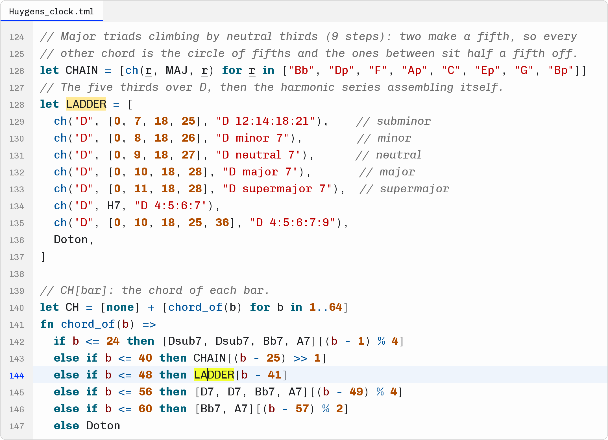
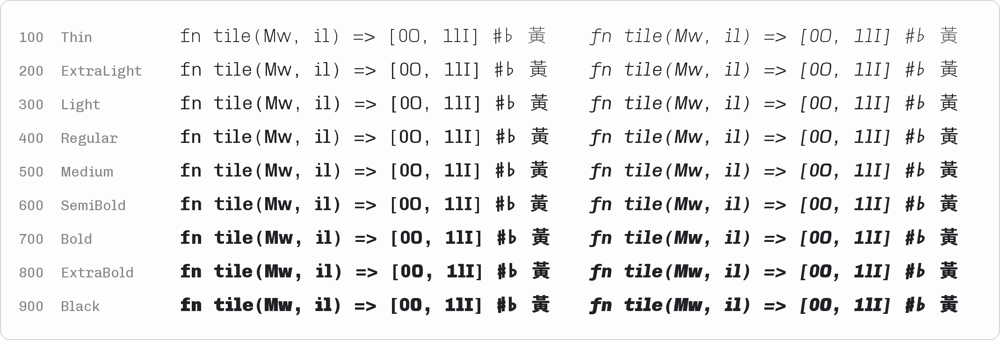
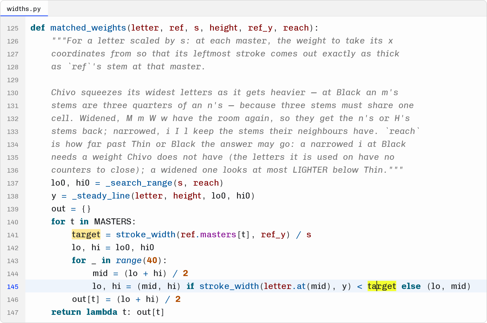
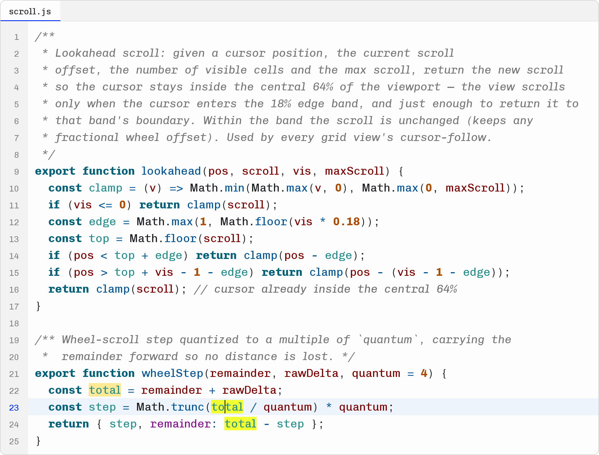

# Motif Code



Motif Code is the typeface of the code editor in [Microtone](https://microtone.cc), the microtonal tracker, where songs can be written as programs in its Motif language. It is made from [Chivo Mono](https://github.com/Omnibus-Type/Chivo) for text that is read as much as it is typed, and it works just as well for any other language.

- **Restricted proportional.** `i I l` take three quarters of a cell and `M m W w` one and a quarter; every other character — digits, punctuation, brackets, operators, the space — stays on the cell. A narrow letter no longer floats in a wide slot and an `m` no longer squeezes three stems into one, while indentation, numbers and brackets still line up. The narrowed and widened letters keep the stems their neighbours have (`n`, `H`) at every weight.
- **O and 0 told apart without a slash or a dot**: the capital O is square and wide, the zero narrow and oval, the way HP's terminals did it.
- **Open C, G and c**, so they do not close up towards O, 0 and 6, or e and o, at small sizes and heavy weights.
- **Music in the font**: ♯ ♮ ♭ 𝄪 𝄫, the triple flat and the Stein-Zimmermann quarter-tone accidentals (Unicode 18), drawn with the letters' own strokes so that they follow the weight, and the twelve Chinese pitch names 黃 大 太 夾 姑 仲 蕤 林 夷 南 無 應, two cells wide.
- **Variable from Thin to Black**, roman and italic, and a static font for each of the nine named weights.



## Not strictly monospaced

Motif Code trades exact columns in words for even words. Text lined up with spaces *after* letters — trailing comments, tables in comments — drifts by a quarter of a cell for every narrow or wide letter before it, as the trailing comments in the picture above do; anything that starts at the same indentation, and every column of digits, still lines up. The font does not claim to be fixed-pitch, so terminal emulators and editors that offer only monospaced fonts will not list it (in JetBrains IDEs, untick *Show only monospaced fonts*).

| Width | Characters |
|---|---|
| ¾ cell (450 units) | `i I l` and their accented forms, `ı`, `ł` |
| 1¼ cell (750 units) | `M m W w` and their accented forms |
| 2 cells (1200 units) | the twelve pitch names |
| 1 cell (600 units) | everything else |

## More of it at work





The pictures are drawn by the build from the fonts it has just made, in [Syntello colour scheme](https://github.com/curioustorvald/syntello-color-scheme), the light IntelliJ colour scheme Microtone's code editor follows; the Python is part of this font's own build, the JavaScript and the Motif program are Microtone's.

## Character set

664 characters: Basic Latin, Latin-1, Latin Extended-A and -B and Latin Extended Additional (Vietnamese included), the combining marks they use, general punctuation, super- and subscripts, currency signs, a few letterlike and mathematical symbols, and the music above. There are no box-drawing characters, arrows, Greek or Cyrillic letters, Powerline symbols or programming ligatures; a system with a fallback font draws those from it.

## Installing

- **Desktop**: install the static fonts in `fonts/ttf/`, or the two variable fonts in `fonts/variable/` — one set or the other, not both, since they share their names.
- **Editors**: choose *Motif Code*. In VS Code, `"editor.fontFamily": "'Motif Code'"`; any weight from 100 to 900 is there (`"editor.fontWeight"`).
- **The web**: serve the two files in `fonts/webfonts/`.

```css
@font-face {
  font-family: "Motif Code";
  src: url("MotifCode-Variable.woff2") format("woff2");
  font-weight: 100 900;
  font-style: normal;
  font-display: swap;
}
@font-face {
  font-family: "Motif Code";
  src: url("MotifCode-Italic-Variable.woff2") format("woff2");
  font-weight: 100 900;
  font-style: italic;
  font-display: swap;
}
code, pre { font-family: "Motif Code", ui-monospace, monospace; }
```

The variable fonts' default instance is Medium (500), the weight Chivo Mono itself is drawn at; set a weight to get another. The fonts are unhinted and ask for smooth rendering at every size.

## Building

```sh
python3 build_dist_package.py              # fonts, specimen pictures, dist/MotifCode-<version>.zip
python3 build_dist_package.py --no-images  # without the pictures
```

Needs Python 3.11+ and fontTools with brotli; the pictures need Pillow and Pygments. The build is deterministic: the same sources and `motif.toml` make the same bytes, the archive included, and `fonts/` is committed so that the fonts can be taken straight from the repository.

Everything is fontTools working on Chivo Mono's own variable fonts (`sources/`), in `motiffont/`: each letter that changes width takes its horizontal coordinates from the weight whose stems, scaled, come out as thick as its neighbours', so it is neither bolder nor lighter for being wider or narrower; the O is redrawn as a superellipse in each master; the terminals of C, G and c are cut further round the bowl and the curves into them refitted with the points they had; and the musical symbols are centre lines stroked with an elliptical nib whose axes are Chivo's stem and bar at that weight. Every dial is in `motif.toml`, with a comment. (The file also configures Microtone's other Motif faces, which this repository does not build.)

Motif is made in Microtone, and this repository carries a copy of what its code face is built from. `python3 build_dist_package.py --sync [PATH]` refreshes `motiffont/`, `sources/`, `motif.toml`, `OFL.txt` and the colour scheme from a Microtone checkout (by default `../microtone-js`) before building.

## Licence

The fonts are licensed under the [SIL Open Font License 1.1](OFL.txt), as their sources are:

- Chivo Mono, © 2018 The Chivo Project Authors (Omnibus-Type). *Chivo is a trademark of Omnibus-Type*, which is why this is called Motif.
- Chiron Hei HK, © 2023–2026 Tamcy, based on Source Han Sans, © 2014–2025 Adobe, for the twelve pitch names (`sources/ChironHeiHK-LICENSE.md`).
- The Motif modifications and symbols, © 2026 The Microtone Project Authors.

Neither source declares a Reserved Font Name.

The build scripts (`build_dist_package.py`, `specimen.py`, `motiffont/`) are part of Microtone and licensed under the [GNU General Public License, version 3 or later](COPYING); so are the code samples in `specimen/samples/`, which are excerpts of it.

## Versions

- **1.003** (2026-10-22) — a longer hyphen (360 units, was Chivo's 253), so `-=` and `--` no longer read as `.=` and `..`.
- **1.002** (2026-10-21) — the first release: Motif Code as Microtone ships it, roman and italic, variable and static.
